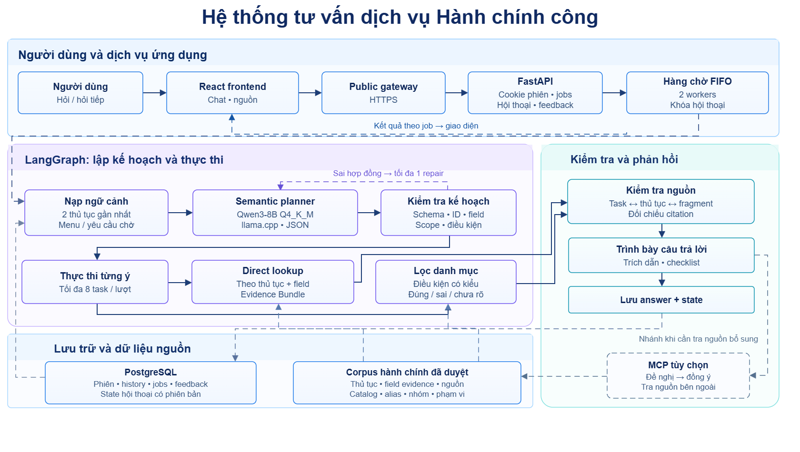
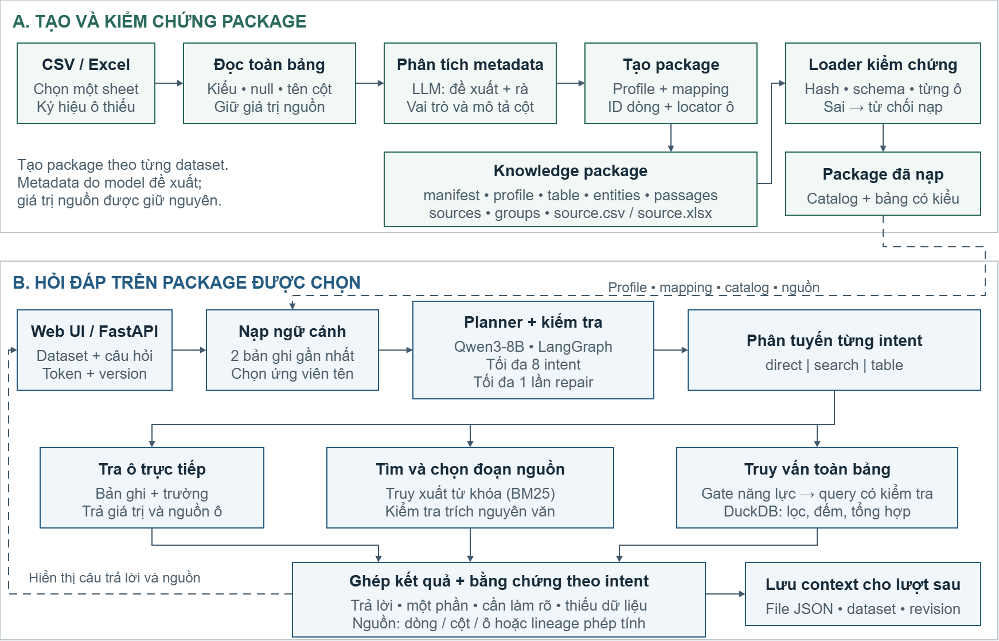

# Hệ thống LLM tư vấn pháp lý & Hệ thống LLM Reusable

Hai hướng triển khai cùng nguyên tắc: **LLM hiểu yêu cầu, chương trình thực thi và đối chiếu dữ liệu nguồn**. Repository gồm mã nguồn, kiểm thử, cấu hình triển khai mẫu và hai hình kiến trúc hiện tại; không chứa model weights, lịch sử người dùng hay cấu hình riêng của máy phát triển.

| Hệ thống | Mục đích | Source và hướng dẫn |
| --- | --- | --- |
| **LLM tư vấn pháp lý — Hệ thống tư vấn pháp lý: Hỗ trợ tra cứu thủ tục hành chính** | Tra cứu 36 thủ tục thuộc phường Tăng Nhơn Phú, Thành phố Hồ Chí Minh; multi-intent và hội thoại nhiều lượt | [LLM tư vấn pháp lý](final/He-thong-LLM-tu-van-phap-ly/README.md) |
| **LLM Reusable — Tự động tạo package từ dữ liệu dạng bảng cho hệ thống LLM** | Upload CSV/Excel → phân tích metadata → tạo package → hỏi đáp trên dataset được chọn | [LLM Reusable](final/He-thong-LLM-reusable/README.md) |

## LLM tư vấn pháp lý: tra cứu thủ tục hành chính



- Tối đa **8 intent trong một tin nhắn**, kể cả các trường thông tin xen kẽ giữa nhiều thủ tục.
- Ngữ cảnh có cấu trúc giữ **2 thủ tục gần nhất**; lịch sử hội thoại lưu riêng trong PostgreSQL.
- Tra cứu hồ sơ, lệ phí, thời gian, nơi nộp và các trường trong nguồn. Truy vấn ngược dùng bộ lọc có kiểu trên bằng chứng đã rà soát; điều kiện chưa đủ nguồn không được tự suy ra.
- Qwen3-8B qua llama.cpp lập kế hoạch JSON; LangGraph kiểm tra và cho phép tối đa một lần sửa kế hoạch. Kết quả ràng buộc với đúng thủ tục, trường và nguồn.
- React/TypeScript cung cấp chat, lịch sử, nguồn tham chiếu, phản hồi và checklist. Hàng đợi FIFO có hai worker theo cấu hình mẫu.

Ví dụ: “Cho tôi giấy tờ đăng ký kết hôn, nơi nộp khai sinh và lệ phí khai tử”. Khả năng trả lời phụ thuộc dữ liệu nguồn và việc xác định đúng yêu cầu, không phải cam kết đúng với mọi cách hỏi.

## LLM Reusable: từ bảng dữ liệu đến package tự động



LLM Reusable hiện **không còn chỉ là bản document-RAG phải chuẩn bị package thủ công**. Workspace mới tiếp nhận CSV/XLSX và quản lý nhiều dataset riêng biệt:

1. Đọc bảng có header, chọn một sheet và khai báo ký hiệu ô thiếu khi cần; giữ nguyên giá trị nguồn.
2. LLM đề xuất mô tả/vai trò các cột, rồi rà lại metadata để chọn cột tên hiển thị và tạo mapping.
3. Chương trình tạo profile, ID từng dòng, bằng chứng từng ô, locator và SHA-256; đóng thành package có phiên bản.
4. Loader kiểm chứng schema, hash, ánh xạ và liên kết về nguồn trước khi nạp.
5. Người dùng chọn dataset để hỏi. Runtime tra cứu, tìm đoạn nguồn hoặc truy vấn toàn bảng có kiểm tra; mỗi intent có kết quả và bằng chứng riêng.

Không cần sửa mapping theo tên từng dataset trong luồng upload tự động. Metadata do model đề xuất **không phải chứng nhận hiểu đúng nghiệp vụ**; hệ thống không tự tạo chính sách, giải mã mã số hoặc thay dữ liệu nguồn bằng kiến thức của model.

UI có kéo thả file, tìm/chuyển bảng, xem cấu trúc, hội thoại mới, mở bằng chứng, sao chép, tải CSV, tải package ZIP và sáng/tối. Mỗi dataset có token/version riêng; context giữ hai bản ghi gần nhất. **Chọn một dataset cho mỗi câu hỏi**, chưa hỗ trợ join hay truy vấn chéo các dataset.

Bản cập nhật 30/10/2026 giữ điều kiện lọc khi nhiều intent cùng hỏi một nhóm dữ liệu, phân biệt thống kê với tra cứu một bản ghi, và tách cột cần hiển thị khỏi điều kiện chọn dòng. Upload thất bại được dọn dữ liệu tạm; CSV sai mã hóa có hướng dẫn lưu UTF-8. UI có tùy chọn ghi nhớ trên trình duyệt và gửi lại cùng lượt khi mất phản hồi mạng.

## Cấu trúc source

```text
.
├── final/                         # Bản bàn giao chính
│   ├── He-thong-LLM-tu-van-phap-ly/
│   │   ├── backend/
│   │   ├── frontend/
│   │   ├── source-service/
│   │   ├── data/administrative/
│   │   └── compose.yaml
│   ├── He-thong-LLM-reusable/
│   │   ├── g85/runtime/
│   │   ├── g85/tabular_lab/
│   │   ├── g85/tests/
│   │   └── compose.yaml
│   ├── assets/
│   ├── report/
│   └── tools/
├── old/                           # Lưu trữ các giai đoạn cũ
└── new/                           # Lưu trữ prototype Design B
```

Hệ thống tư vấn pháp lý còn namespace `g3`, `g4`, `g5`, `g7` cho các module nền được import; không phải các hệ thống cũ phải khởi động. LLM Reusable mới độc lập, không cần database, frontend hay snapshot LLM tư vấn pháp lý.

## Chạy trên máy riêng

Cần **Docker + Compose** và model server `/v1/chat/completions` hỗ trợ JSON-schema output. Cấu hình tham chiếu dùng **Qwen3-8B GGUF Q4_K_M qua llama.cpp**, không fine-tune để ghi nhớ dataset. Weights và giấy phép model do người triển khai chuẩn bị riêng.

Ví dụ model server cho LLM Reusable; thay đường dẫn/tài nguyên theo máy:

```powershell
llama-server -m /path/to/Qwen3-8B-Q4_K_M.gguf --alias G85-Tabular-Qwen3-8B-Q4 --host 0.0.0.0 --port 18085 --jinja --reasoning off --ctx-size 12288 --parallel 1 --n-gpu-layers 99 --temp 0 --seed 42 --chat-template-kwargs '{"enable_thinking":false}'
```

Model nghe `0.0.0.0` để container truy cập qua host; **phải chặn truy cập bên ngoài bằng firewall**. Không public inference endpoint không có xác thực. Endpoint khác cần được kiểm thử lại schema, context, chất lượng và thời gian xử lý.

Chuyển vào thư mục hệ thống tương ứng dưới `final/`, rồi chạy:

```powershell
Copy-Item .env.example .env
# Sửa model URL/name; LLM tư vấn pháp lý còn cần DB_PASSWORD riêng đủ mạnh.
docker compose --env-file .env config --quiet
docker compose up -d --build --wait
```

| Hệ thống | Địa chỉ local mặc định |
| --- | --- |
| LLM tư vấn pháp lý | http://localhost:13008 — backend http://localhost:18008/health |
| LLM Reusable | http://localhost:13085 — UI, `/docs`, `/health` cùng origin |

LLM Reusable mở trang là có thể upload, **không cần tạo package trước khi chạy**. Model phải sẵn sàng trước khi upload/hỏi. `/health` chỉ báo API/hàng đợi, không chứng nhận model sẵn sàng. Các địa chỉ trên không phải link public luôn hoạt động.

LLM Reusable bổ sung `/ready` để kiểm tra kết nối và model đã nạp; endpoint này trả 503 khi model chưa sẵn sàng hoặc hàng đợi đã đầy. Đây là kiểm tra vận hành, không đánh giá chất lượng câu trả lời.

LLM tư vấn pháp lý giữ dữ liệu trong volume PostgreSQL; LLM Reusable dùng volume `datasets`. Không dùng `docker compose down -v` nếu cần giữ dữ liệu. Không tái sử dụng volume của deployment cũ khi chưa sao lưu/kiểm tra tương thích.

## Kiểm thử

LLM tư vấn pháp lý backend, trong `He-thong-LLM-tu-van-phap-ly/backend/`:

```powershell
uv sync --frozen
uv run pytest -q
```

LLM tư vấn pháp lý frontend, trong `frontend/`:

```powershell
npm ci
npm test
npm run build
```

LLM Reusable, trong `He-thong-LLM-reusable/`, Python 3.12:

```powershell
python -m venv .venv
.venv/Scripts/python.exe -m pip install -r requirements.txt
.venv/Scripts/python.exe -m pytest g85/tests g85/tabular_lab -q
```

Linux/macOS dùng `.venv/bin/python`. Test offline dùng dữ liệu tổng hợp và model giả lập; không cần GPU và **không phải accuracy benchmark LLM**. README từng hệ thống có hướng dẫn UI. Từ gốc repo chạy `python final/tools/check_public_tree.py` để rà file đưa lên Git.

### Kiểm chứng bản cập nhật 30/10/2026

| Phép kiểm tra | Kết quả |
| --- | ---: |
| Reusable offline, gồm kiểm thử sửa lỗi | 201/201 |
| Backend tư vấn pháp lý offline | 223/223 |
| Reusable API trên 11 dataset, giữ nguyên bộ hồi quy | 218/221 |
| Bốn câu lỗi ban đầu sau sửa | 4/4 |
| Đổi nhóm, toàn bảng và tham chiếu nhóm mơ hồ | 4/4 |
| Tư vấn pháp lý API, giữ nguyên bộ 143 lượt | 142/143 |
| Browser thật: khôi phục tab, retry, mobile, CSV | 6/6; không có lỗi JavaScript |

Ba ca Reusable còn lại trả `partial` do thiếu ô nguồn hoặc giới hạn 1.000 dòng. Pháp lý còn một ca từ chối quá mức khi người dùng yêu cầu đoán phí của thủ tục có trường phí thiếu dữ liệu. Các câu lỗi dùng để phát triển được đánh giá lại như kiểm thử hồi quy; các tỷ lệ này không đại diện cho mọi cách diễn đạt hay mọi dataset. Đợt kiểm tra dùng chung model local, không phải phép đo tốc độ trong môi trường cô lập.

[Kết quả kiểm chứng dạng JSON](final/verification/20261030/summary.json). Dữ liệu upload, token, cấu hình riêng và log hội thoại được giữ ở máy kiểm thử.

## Phạm vi và bảo mật

- **LLM tư vấn pháp lý** phục vụ nguồn của phường Tăng Nhơn Phú, không tự áp dụng cho địa phương khác hoặc bảo đảm thủ tục còn hiệu lực. 36 thủ tục runtime khác với 42 dòng release nguồn.
- **LLM Reusable** nhận một bảng có header mỗi upload, CSV UTF-8 hoặc XLSX; tối đa 20 MiB, 32 cột và 100.000 ô cho package. Chưa có PDF/DOCX, join, workbook bố cục tự do, quy đổi đơn vị hoặc giải mã codebook. Bộ lọc ngữ nghĩa tự do trên văn bản chưa bật trong API.
- Chuỗi `NA` được giữ nguyên trừ khi người dùng khai báo nó là ký hiệu thiếu; ô thiếu không tự là 0. Hash kiểm tra tính toàn vẹn, không chứng minh dữ liệu/metadata đúng về ngữ nghĩa.
- **LLM tư vấn pháp lý** dùng cookie trình duyệt để khôi phục lịch sử ở server; tài khoản Google giống nhau trên hai máy không tự đồng bộ cookie. **LLM Reusable** có tùy chọn lưu danh sách bảng/token và 20 lượt hiển thị gần nhất trong cùng trình duyệt; bỏ chọn để giữ phiên tab. File và context lưu riêng ở server. Chưa có đồng bộ tài khoản giữa thiết bị hoặc khôi phục token sau khi xóa bộ nhớ trình duyệt.
- Compose mẫu chỉ bind localhost. LLM Reusable chưa có tenant/account auth đầy đủ, thu hồi token, quota đĩa hay chức năng xóa dữ liệu cho production. Public cần HTTPS, xác thực, rate limit, quản trị dữ liệu và sao lưu, không chỉ đổi host sang `0.0.0.0`.

Thư mục `final/report/` chứa hai PDF được công bố cùng source. Không kèm bộ benchmark riêng, dataset thử tải từ bên thứ ba, tài khoản, `.env` thật, tunnel state, logs hay weights. Quyền sử dụng model, thư viện và dữ liệu bên thứ ba vẫn theo giấy phép tương ứng.


